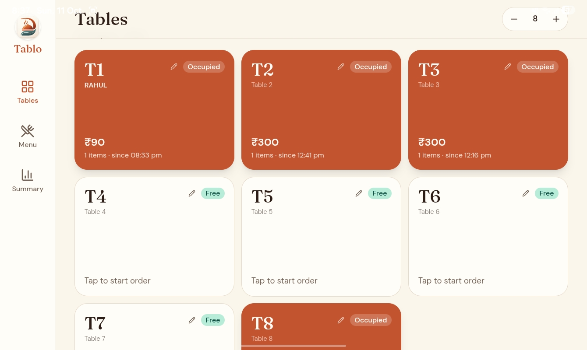
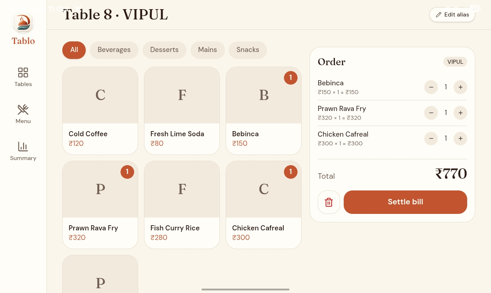
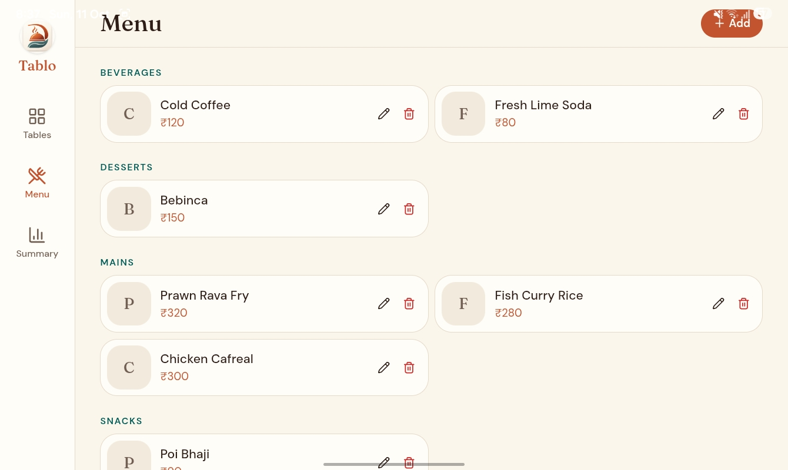
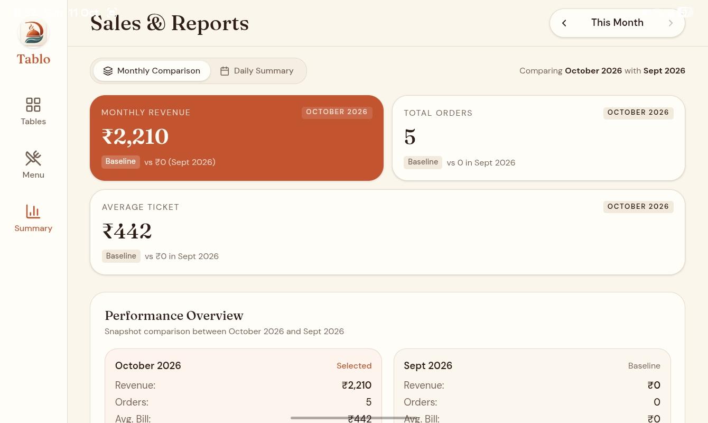

<p align="center">
  
</p>

<h1 align="center">Tablo</h1>

<p align="center">
  <strong>Offline-first order management for cafes and restaurants.</strong><br />
  Tables, menu, billing, and sales reports — on Android mobile, tablet, or the web.
</p>

<p align="center">
  <a href="../../releases"></a>
  
  
  
</p>

<p align="center">
  <a href="#screenshots">Screenshots</a> ·
  <a href="#features">Features</a> ·
  <a href="#get-tablo">Get Tablo</a> ·
  <a href="#development">Development</a>
</p>

---

## Screenshots

| Tables | Table order | Menu | Sales & reports |
| --- | --- | --- | --- |
|  |  |  |  |

## Features

### Tables
- Live table grid with Occupied / Free status, running total, item count, and order start time
- Configurable table count (1–60) with add / remove controls
- Table aliases (e.g. Rahul, VIP Booth) with add, edit, and clear
- Tap a table to open its order

### Ordering & billing
- Category filter pills (All + every menu category) and fast-tap product grid with photos
- Quantity badges on items already in the order
- Active order panel with quantity steppers, line totals, and order total in INR
- Clear-table and settle-bill flows with confirmation

### Menu management
- Add, edit, and delete products with name, price, category, and optional photo
- Category-grouped menu list
- Seeded demo menu on first run so the app is usable immediately

### Sales & reports
- Daily summary: revenue, orders, average bill, items sold, and settled bills, with day navigation (up to 180 days back)
- Monthly comparison: revenue, orders, and average ticket for the selected month vs the previous month, with diff and percent change
- Item performance comparison per product (quantity, revenue, change, trend indicators)
- Performance overview and growth commentary

### Offline-first by design
- On-device SQLite via `@capacitor-community/sqlite` on Android; same database on web via `jeep-sqlite` + IndexedDB
- In-memory UI state with write-through to SQLite — instant taps, data survives restarts
- 6-month (180-day) retention for settled bills, enforced with an indexed range delete
- No server or account needed — all data stays on-device

## Get Tablo

The installable Android build is published as an APK on [GitHub Releases](../../releases).

1. Download the latest `Tablo.apk` (or versioned `Tablo-vX.Y.Z.apk`) from Releases
2. Install it directly on Android (enable **Install unknown apps** if prompted)
3. Open Tablo and start taking orders — works fully offline

> Maintainer note: build with `npm run cap:apk`, then attach the resulting
> `Tablo-debug.apk` to a new GitHub Release.

## Tech stack

| Layer | Technology |
| --- | --- |
| App | React 19, Vite, TanStack Router / Start, TanStack Query |
| Styling | Tailwind CSS 4 |
| Mobile | Capacitor 8 (Android) |
| Data | On-device SQLite (`@capacitor-community/sqlite`, `jeep-sqlite` on web) |
| Quality | TypeScript, Vitest |

## Development

You need Node.js and npm — [install with nvm](https://github.com/nvm-sh/nvm#installing-and-updating).

```sh
git clone <this-repository-url>
cd <repository-name>
npm i
npm run dev
```

Useful scripts:

```sh
npm test          # run Vitest suite
npm run build     # web / SSR build
npm run cap:apk   # mobile web build + Capacitor sync + Gradle debug APK (see scripts/build-apk.cjs)
```

## Credits

Tablo's UI was made with [Lovable](https://lovable.dev).
